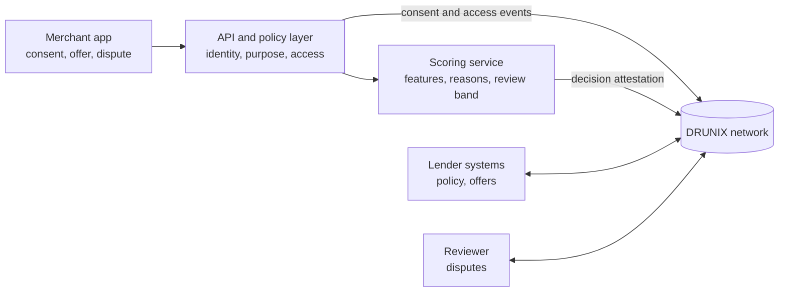

# Architecture

Status: proposed design. To be validated against current DRUNIX documentation and a tested environment.

## Principle

Private intelligence stays off-chain. Shared workflow state lives on DRUNIX. Raw transactions and personal identifiers never go on an immutable ledger.

## Diagram

## Components

| Component | Responsibility | Off-chain or on-ledger |
|---|---|---|
| Merchant app | Collect consent, show offer and reasons, open disputes | Off-chain |
| API and policy layer | Check identity, purpose and access; enforce expiry and revocation | Off-chain |
| Scoring service | Derive features from cash-flow summaries, return a suggested review band with plain-language reasons | Off-chain |
| DRUNIX network | Shared record of consent, decisions, offers, repayment events and disputes | On-ledger |
| Lender systems | Own credit policy, pricing, disclosures and servicing | Off-chain, writes offers to the ledger |
| Reviewer | Resolves disputes | Writes outcomes to the ledger |

## What goes on the ledger

- Consent receipts: purpose, permitted recipient, scope, timestamp, expiry, status.
- Decision attestations: decision ID, model version, reason digest, input fingerprint.
- Offer and lifecycle state: offer, acceptance, simulated repayment events.
- Dispute trail: state, evidence reference, outcome.
- Audit events for permitted data access.

## What stays off the ledger

- Raw transactions and personal identifiers.
- Model inference and feature values.
- Lender credit policy and pricing logic.

## Organisations and endorsement (proposed)

Four organisations: merchant side, scoring provider, lender, reviewer. Each endorses the transactions that concern it. For example, offer acceptance is endorsed by both lender and merchant. Exact endorsement policies, private data collections and peer topology are to be confirmed with DRUNIX mentors.

## Open questions for mentors

1. Recommended peer topology for a four-organisation prototype.
2. Private data and KeyDB transient store configuration for consent scope details.
3. State database choice for lender audit queries (YugabyteDB is a candidate).
4. How to use the stateless validation service in a local network.
5. Which contributions to DRUNIX are in scope.
